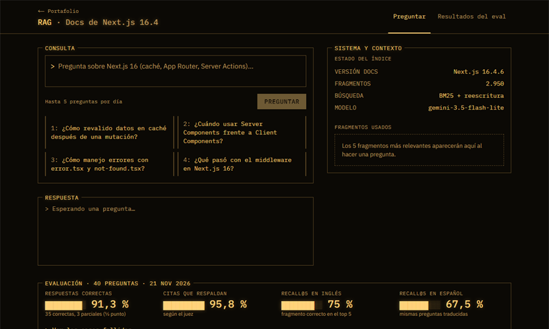
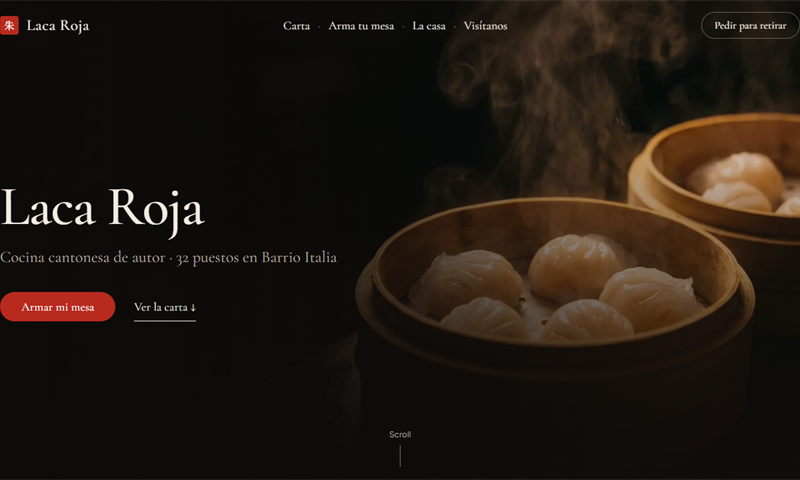

<picture>
  <source media="(prefers-color-scheme: dark)" srcset="./assets/header-dark.png" />
  <source media="(prefers-color-scheme: light)" srcset="./assets/header-light.png" />
  
</picture>

Ingeniero en Informática con más de 4 años trabajando con SQL, procesos ETL y automatización. Uso esa base para construir con agentes de IA (Claude Code, Antigravity, Hermes Agent) y publicar proyectos con pruebas y evaluaciones medidas.

<table>
  <tr>
    <td width="33.3%" align="center" valign="top">
      <strong>Buscador RAG · Next.js 16</strong>  
        
      <code>91 % acierto · 96 % citas</code> 
      BM25 + Gemini · 40 preguntas con Groq como juez  
      <a href="https://rag-docs-nextjs.vercel.app">Demo</a> ·
      <a href="https://github.com/DanielAlejandro-Analytics/rag-docs-nextjs">Código</a> ·
      <a href="https://rag-docs-nextjs.vercel.app/resultados">Evals</a>
    </td>
    <td width="33.3%" align="center" valign="top">
      <strong>Agente SQL</strong>  
        
      <code>93,3 % exacto · 65 tests</code> 
      Español a SQL solo lectura · 28/30 filas exactas  
      <a href="https://agente-sql.vercel.app">Demo</a> ·
      <a href="https://github.com/DanielAlejandro-Analytics/agente-sql">Código</a>
    </td>
    <td width="33.3%" align="center" valign="top">
      <strong>Laca Roja (demo)</strong>  
        
      <code>Next.js 16 · React 19 · WebGL</code> 
      Carta, pedido, checkout simulado y seguimiento  
      <a href="https://laca-roja.vercel.app">Demo</a> ·
      <a href="https://github.com/DanielAlejandro-Analytics/laca-roja">Código</a>
    </td>
  </tr>
</table>

**Cómo trabajo y verifico antes de publicar**

- Escribo instrucciones, reglas y skills reutilizables para que un agente complete una tarea de punta a punta y la repita igual.
- Mantengo una base de conocimiento en Markdown y Obsidian con estado, decisiones y errores resueltos entre sesiones.
- Pruebo antes de desplegar en Vercel: evaluaciones medidas con casos fallidos públicos, pruebas automatizadas y repositorios con `.env.example` sin secretos en git.

**Herramientas:** `Claude Code` · `Antigravity` · `Hermes Agent` · `Codex` · `Gemini` · `Groq` · `SQL Server` · `PostgreSQL` · `MySQL` · `SQLite` · `Pentaho` · `Jenkins` · `Power Automate` · `Power BI` · `Python` · `Next.js` · `TypeScript` · `Tailwind` · `Vercel`

  <a href="https://portafolio-dbarros.vercel.app">Portafolio</a> ·
  <a href="https://www.linkedin.com/in/danielbarrosgonzalez/">LinkedIn</a> ·
  <a href="mailto:dbarrosg@outlook.com">dbarrosg@outlook.com</a>

