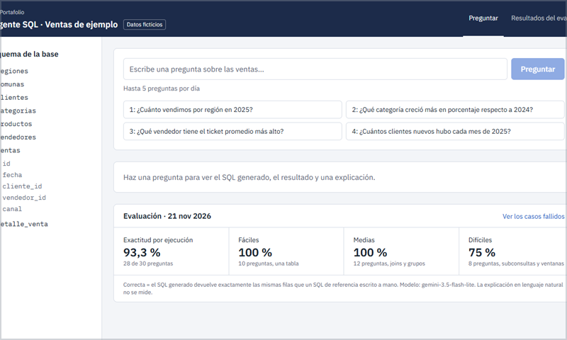
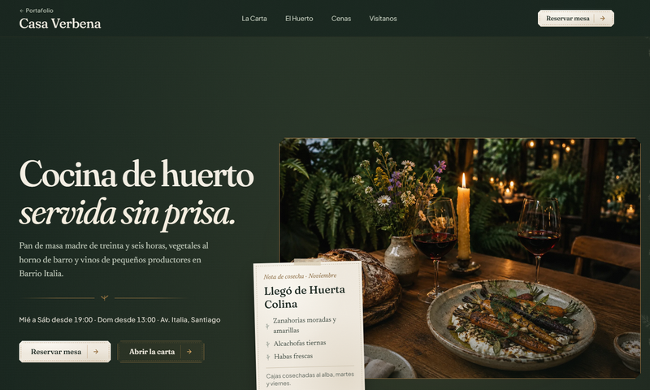

<picture>
  <source media="(prefers-color-scheme: dark)" srcset="./assets/header-dark.png" />
  <source media="(prefers-color-scheme: light)" srcset="./assets/header-light.png" />
  
</picture>

Ingeniero en Informática con más de 4 años trabajando con SQL, procesos ETL y automatización. Uso esa base para construir con agentes de IA (Claude Code, Antigravity, Hermes Agent) y publicar proyectos con pruebas y evaluaciones medidas.

[Portafolio](https://portafolio-dbarros.vercel.app) · [LinkedIn](https://www.linkedin.com/in/danielbarrosgonzalez/) · [dbarrosg@outlook.com](mailto:dbarrosg@outlook.com)

<table>
  <tr>
    <td width="33.3%" align="center" valign="top">
      <strong>Buscador RAG · Next.js 16</strong> 
       
      <code>91% acierto · 96% citas</code> 
      BM25 + Gemini · 40 preguntas (juez Groq) 
      <a href="https://rag-docs-nextjs.vercel.app">Demo</a> ·
      <a href="https://github.com/DanielAlejandro-Analytics/rag-docs-nextjs">Código</a> ·
      <a href="https://rag-docs-nextjs.vercel.app/resultados">Evals</a>
    </td>
    <td width="33.3%" align="center" valign="top">
      <strong>Agente SQL</strong> 
       
      <code>93,3% exacto · 65 tests</code> 
      Español a SQL solo lectura · 28/30 filas 
      <a href="https://agente-sql.vercel.app">Demo</a> ·
      <a href="https://github.com/DanielAlejandro-Analytics/agente-sql">Código</a>
    </td>
    <td width="33.3%" align="center" valign="top">
      <strong>Casa Verbena (demo)</strong> 
       
      <code>React 19 · Vite · Motion</code> 
      Carta en libro que se hojea y reservas 
      <a href="https://casa-verbena.vercel.app">Demo</a> ·
      <a href="https://github.com/DanielAlejandro-Analytics/laca-roja">Código</a>
    </td>
  </tr>
</table>

**Cómo trabajo**

- Escribo instrucciones, reglas y skills reutilizables para que un agente ejecute una tarea de punta a punta y la repita igual.
- Mantengo notas en Markdown y Obsidian con estado, decisiones y errores resueltos para dar continuidad entre sesiones.
- Verifico antes de publicar en Vercel con pruebas automatizadas, evaluaciones con casos fallidos públicos y repos limpios sin secretos en git.

**Herramientas**

- **IA y agentes:** Claude Code, Antigravity, Hermes Agent, Codex, Gemini y Groq (RAG, text-to-SQL y evaluación con LLM como juez).
- **Datos y automatización:** SQL Server, PostgreSQL, MySQL, SQLite, Pentaho, Jenkins, Power Automate, Power BI y Python.
- **Web (con asistencia de IA):** Next.js, React, Vite, TypeScript, Tailwind y Vercel.